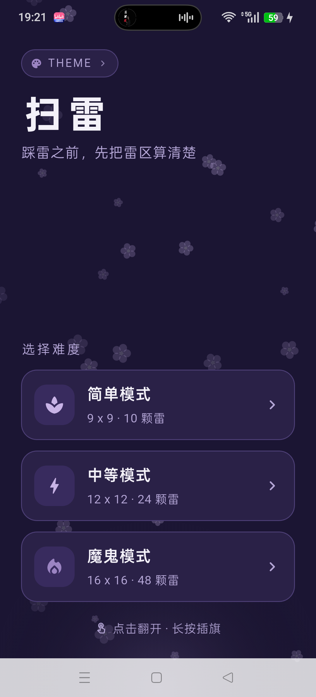
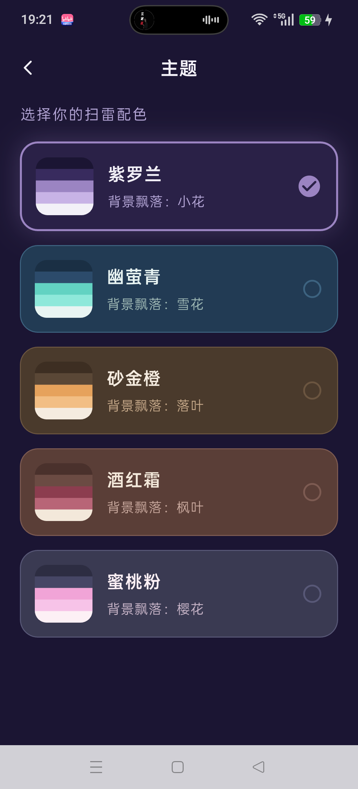
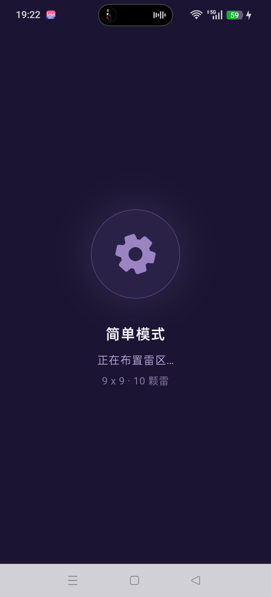
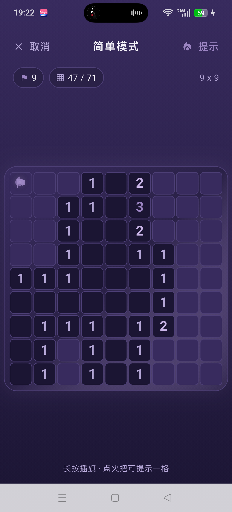
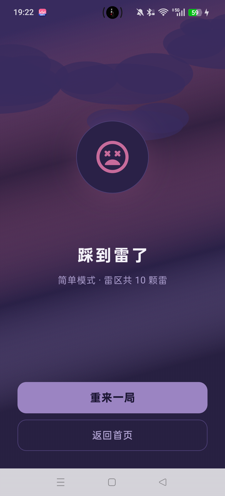
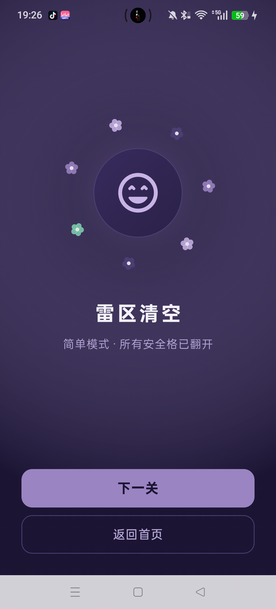

# 扫雷（Minesweeper）· Flutter

一个用 Flutter 实现的移动端扫雷小游戏，三种难度、五套可切换主题，每个主题都有独立的飘落花纹与配色。

## 为什么做这个 App

- 课程要求做一个「组件 + 动画」的完整小项目，扫雷的交互逻辑单纯，正好把刚学的**布局组件、可滚动组件、动画组件**串起来用一遍。
- 玩过很多扫雷，但界面大多停留在十几年前的像素风。想把「深色配色 + 飘落粒子 + 呼吸光效」这类现代移动端视觉加进去，让它既是练习作品，也是一个自己愿意每天打开的小游戏。
- 五种主题来自平时收集的配色参考（紫罗兰、幽萤青、砂金橙、酒红霜、蜜桃粉），每个主题配一种飘落花纹（小花 / 雪花 / 落叶 / 枫叶 / 樱花），切换后整个 App 的配色和背景动画同步变化。

## 功能

### 游戏
- **三种难度**：简单 9 × 9 · 10 雷、中等 12 × 12 · 24 雷、魔鬼 16 × 16 · 48 雷
- **点击翻开**：数字格显示周围雷数（1~8 各有独立配色），空格自动扩散
- **长按插旗**：标记可疑雷格，旗帜数实时倒扣
- **首次点击保护**：第一下永远踩不到雷
- **提示**：随机翻开一格安全区域，卡局时救急
- **胜负结算**：清空雷区进入成功页（可下一关），踩雷进入失败页（可重来）
- **状态实时显示**：剩余雷数、已翻开格数 / 总安全格数、棋盘尺寸

### 主题
- 5 套主题，随时切换，**首页、主题页、加载页、游戏页、结算页全部同步换色**
- 每套主题包含背景、卡片、分割线、强调色、危险色、成功色、数字 1~8 配色共 11 组颜色
- 每套主题独立飘落花纹：紫罗兰-小花、幽萤青-雪花、砂金橙-落叶、酒红霜-枫叶、蜜桃粉-樱花

### 动画（共 12 处，6 类）

| # | 动画效果 | 使用位置 | 实现方式与关键参数 |
| --- | --- | --- | --- |
| 1 | 背景花纹持续飘落 + 自转 | 首页 `_PatternPainter` | `AnimationController` 16s 循环 + `AnimatedBuilder` + `CustomPaint`；30~48 个粒子，按主题绘制小花 / 雪花 / 落叶 / 枫叶 / 樱花 |
| 2 | 三张难度卡片依次淡入上移 | 首页 `_ModeCard` | `TweenAnimationBuilder` 420ms + index×120ms，`easeOutCubic`，`Opacity` 0→1 配 `Transform.translate` 下移 18→0 |
| 3 | 齿轮旋转 | 加载页 `_LoadingPageState` | `AnimationController` 2200ms 循环 + `RotationTransition` |
| 4 | 加载圈呼吸缩放 | 加载页 `_LoadingPageState` | `AnimationController` 1200ms 往返，`Tween` 0.88→1.08，`easeInOut` + `ScaleTransition` |
| 5 | 棋盘流光呼吸 | 游戏页 `_buildBoardArea` | `AnimationController` 5s 循环 + `AnimatedBuilder`，`sin()` 驱动渐变起止点与光晕透明度 |
| 6 | 翻格底色过渡 | 游戏页 `_CellTile` | `AnimatedContainer` 150ms `easeOut`（底色、边框、圆角） |
| 7 | 数字 / 旗帜缩放弹出 | 游戏页 `_CellTile` | `AnimatedSwitcher` 180ms + `ScaleTransition` 0.6→1（`easeOutBack`）+ `FadeTransition` |
| 8 | 火焰跟随手指并闪烁 | 游戏页 `_buildBoardArea` | `Listener` 记录触点 → `AnimatedPositioned` 220ms `easeOut` 跟随；`AnimationController` 620ms 往返驱动透明度 0.35→0.9、缩放 0.85→1.1 |
| 9 | 踩雷全屏爆炸 | 游戏页 `_BoomPainter` | `AnimationController` 1100ms 单次播放：全屏闪光 + 3 层冲击波圆环 + 中心径向光晕 |
| 10 | 小花环绕笑脸旋转 | 结算页（成功）`_FlowerRingPainter` | `AnimationController` 14s 循环 + `Transform.rotate`，7 朵五瓣小花按主题色绘制 |
| 11 | 乌云漂移 + 色彩流动 | 结算页（失败）`_CloudPainter` | `AnimationController` 10s 循环，渐变起止点随时间移动 + 7 团椭圆乌云横向漂移 |
| 12 | 主题卡选中反馈 | 主题选择页 `_ThemeCard` | `AnimatedContainer` 220ms（边框宽度、发光阴影）+ `AnimatedSwitcher` 180ms 切换勾选图标 |


## 截图

| 首页 | 主题选择 |
| --- | --- |
|  |  |

| 加载页 | 游戏页 |
| --- | --- |
|  |  |

| 失败页 | 成功页 |
| --- | --- |
|  |  |

## 技术栈

- Flutter 3.x / Dart 3.x
- Material 3（深色主题）
- 未使用状态管理库，主题切换基于 `StatefulWidget + InheritedWidget`
- 动画全部使用 Flutter 原生 `AnimationController`、`AnimatedBuilder`、`TweenAnimationBuilder`、`AnimatedContainer`、`AnimatedSwitcher`、`CustomPainter`

## 目录结构

```
lib/
├── main.dart                # 入口，主题外壳
├── app_theme.dart           # 5 套主题色板 + 粒子类型 + 难度配置
├── theme_scope.dart         # 主题状态与广播
├── game_logic.dart          # 布雷、翻格、插旗、胜负判定
└── pages/
    ├── home_page.dart       # 首页（模式选择 + 主题入口 + 粒子背景）
    ├── theme_page.dart      # 主题选择页
    ├── loading_page.dart    # 加载页
    ├── game_page.dart       # 游戏页（棋盘 + 火焰 + 爆炸）
    └── result_page.dart     # 结算页（成功 / 失败）
```

## 运行与打包

### 环境准备

```bash
flutter pub get
```

### Flavor 配置

`android/app/build.gradle.kts` 中定义了两个产品 flavor（参考 Flutter 官方《为 Android 配置 flavor》文档）：

| flavor | applicationId | 应用显示名 | 用途 |
| --- | --- | --- | --- |
| `dev` | `com.xx.minesweeper_app.dev` | 扫雷 Dev | 日常开发调试，可与正式版同时安装 |
| `prod` | `com.xx.minesweeper_app` | 扫雷 | 发布版本 |

应用名通过 `resValue` 生成 `app_name` 字符串，`AndroidManifest.xml` 用 `@string/app_name` 引用；Dart 侧用 `appFlavor` 区分环境。

### 运行

```bash
flutter run --flavor dev      # 开发版
flutter run --flavor prod     # 正式版
```

### 打包 APK

```bash
# 单包（含所有 ABI，体积较大）
flutter build apk --release --flavor prod

# 按 ABI 拆包（推荐，安装包更小）
flutter build apk --release --flavor prod --split-per-abi
```

产物在 `build/app/outputs/flutter-apk/`：

| 文件 | 适用设备 |
| --- | --- |
| `app-arm64-v8a-prod-release.apk` | 绝大多数 Android 手机 |
| `app-armeabi-v7a-prod-release.apk` | 老旧 32 位设备 |
| `app-x86_64-prod-release.apk` | 模拟器 |

### 已构建的安装包

**[下载 minesweeper-v1.0.0-arm64-v8a.apk](apk/minesweeper-v1.0.0-arm64-v8a.apk)**（15.2 MB，适用于 arm64 手机，直接传到手机安装即可）

> 说明：release 构建目前沿用 Flutter 模板的 debug 签名（`signingConfigs.getByName("debug")`），可直接侧载安装，但**不能上架应用商店**。正式发布前需要生成自己的 keystore 并配置 signingConfig。

## 后续计划

- [ ] 主题选择本地持久化，重开 App 保留上次选择
- [ ] 记录各难度最佳时间
- [ ] 配置正式签名（keystore）并构建 appbundle 上架
